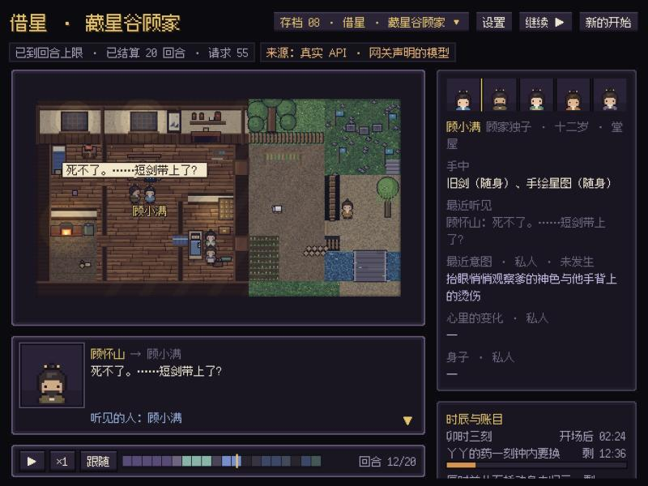

# 浮生镇 Fusheng

*浮生一镇，人各有事。*

一座会自己过日子的像素小镇。每个人物各自感知、记忆、权衡，然后开口、动手，或者沉默。世界不替任何人做决定，只结算真正发生了什么：谁走到了哪里，哪句话被谁听见，哪件东西真的换了手。



## 演示：《借星》· 离家那天的清晨

《借星》是作者原创的仙侠动画剧本。演示截取第一集里的一个早晨：**十二岁的顾小满离家那天，卯时三刻**。

- 前一夜修阵失败，父亲顾怀山双手灼伤；邻家小女孩丫丫昏睡在药房，身上的黑纹一刻钟内必须换药压住。
- 父亲袖中藏着已经续上剑宗印记的接引符，父母已经商定由母亲送小满去归云岭，辰时前要从石桥动身。**小满对这些一无所知。**
- 小伙伴阿宝在篱笆外，要来送别，却不知道送的是什么。

世界只摆出事实和时限。去不去、说不说、怎么说，都由人物自己决定。下面是演示存档里模型实际说出、并且被世界结算送达的几句：

> **顾小满**：……手上的伤，还疼不疼？
>
> **顾怀山**：死不了。……短剑带上了？
>
> **陆青禾**：何嫂，先别碰她手臂，我这就给她换药。
>
> **顾小满**：带上了，就在身上收着。
>
> **阿宝**：真带了？那你拿这些到底要去哪啊？昨晚谷口那动静……是不是真出事了？

**不用 API 密钥也能看**：按下面的步骤启动后打开 `http://127.0.0.1:8787/stage.html`，在存档列表里回放 `jiexing-demo-20turns`。这是一次 20 回合的真实模型运行。

世界设定和剧本原文在 [`src/worlds/jiexing/beacon/`](src/worlds/jiexing/beacon/)，选场理由见 [`src/worlds/jiexing/README.md`](src/worlds/jiexing/README.md)。

## 设计要点

- **没有场景导演**：不存在一个替所有人写戏的"总编剧"调用。每个人物是独立的代理，经过 评估 → 候选 → 选择 → 原子提交 四步，自己决定下一步。
- **世界只结算事实**：动作是否成功、话有没有传到、谁在场听见或看见，都由确定性规则结算。没发生的事不会进入任何人的记忆，失败会带着原因回到人物那里。
- **意图和事实分开**：人物的私人念头、没说出口的话，只在观察台上标为"私人"，不会被当成已经发生的事。
- **世界包**：一个世界就是一份纯数据（`src/worlds/<id>/pack.mjs`），包括地形、人物、物件、工作、社会规则、时限和保留的悬念，可以静态校验、零模型调用冒烟。
- **花钱前先问**：每次真实模型运行都要先勾选授权、设回合和请求上限；密钥只从本机设置或进程环境读取，页面和接口都不会返回。
- **契约测试**：600 多个契约脚本覆盖结算、感知、持久化和人物协议，`npm test` 一次跑完。

## 三步开始玩

1. **装 Node.js**：到 <https://nodejs.org/> 下载并安装 24 或更新的版本。不需要装别的东西。
2. **双击启动**：macOS 双击 `start.command`，Windows 双击 `start.bat`。浏览器会自动打开 `http://127.0.0.1:8787/play.html`。关掉那个黑色窗口，小镇就停了。
   - 第一次在 macOS 上双击，如果提示“无法打开”，右键 → 打开，再确认一次。
   - macOS 还可以生成一个桌面图标：在终端里运行 `zsh scripts/mac-launcher/build.sh`，桌面上会多出「人物小镇」。双击它，小镇在后台启动（端口 8788）并打开开始界面，关掉浏览器也不会停。要停就运行 `zsh scripts/mac-launcher/stop.sh`。项目文件夹移动以后，重新运行一次 build.sh。
3. **填 API**：开始界面会先弹出“设置”。填上模型服务的 API 密钥：可以用 Google Gemini 官方、DeepSeek 官方，或者兼容 OpenAI 接口的网关。点“测试连接”，没问题就保存。

然后点 **新的世界**：
- **快速模式**：写一句话，模型起草整座小镇；
- **捏世界模式**：自己一页一页捏，不用模型也能完成。
- **导入剧本**：把剧本、小说片段或设定稿贴进来，或者选 .txt / .md / .fountain 文件（可以多选、拖进窗口；Windows 记事本存的 GBK 文本也能读）。窗口会显示模型实际读到多少字、按台词粗略认出了哪些人物；选“按原作改编”时，人物、关系、地方和开场都以原作为准，选“只作参考”则只是取材。快速模式里也能随时打开这个窗口。

检查、预览地图以后点“开始”，就能在观察台看镇上的人过日子。

**你的东西放在哪里：**
- 设置、你建的世界、存档，都在你的用户目录 `~/.character-town/` 里（Windows 是 `C:\Users\<你>\.character-town\`），升级程序不会动它们。
- 密钥只保存在这台电脑的 `settings.json` 里（只有你能读），页面和接口都不会把它发回来。
- 每次让人物过日子都会调用模型、产生费用。开始前页面会估算调用次数，并要你勾选授权、设上限。

## 致谢与参考

这些项目和理论给了思路，本仓库没有复制它们的代码：

- Park et al., *Generative Agents: Interactive Simulacra of Human Behavior*（2023，斯坦福"Smallville"）：感知、记忆、反思、计划的人物循环。
- [a16z-infra/ai-town](https://github.com/a16z-infra/ai-town)：实时世界和慢速模型调用分开推进。
- [SillyTavern](https://github.com/SillyTavern/SillyTavern)：群聊里用廉价规则挑选发言人。
- BDI（信念—欲望—意图）模型、情绪的评估理论（appraisal theory），以及《模拟人生》式的需求与日程。

字体：[Fusion Pixel Font](https://github.com/TakWolf/fusion-pixel-font)（TakWolf）和 [Boutique Bitmap 9x9](https://github.com/scott0107000/BoutiqueBitmap9x9)（字言字型），均为 SIL OFL 1.1，详见 [`assets/fonts/`](assets/fonts/)。

## 授权

本仓库采用**双重授权**，详见 [NOTICE.md](NOTICE.md)：

| 内容 | 授权 |
|---|---|
| 程序代码（引擎、服务端、页面、脚本、测试） | [AGPL-3.0](LICENSE) |
| 原创故事：《借星》《逍遥游》的世界观、剧本、人物设定与台词，人物立绘和场景美术 | [CC BY-NC-ND 4.0](LICENSES/CC-BY-NC-ND-4.0.txt) |

简单说：代码可以自由使用、修改、再分发，但改过的版本（包括架成网络服务给别人用）必须同样以 AGPL-3.0 公开源码；故事和美术可以署名转载、非商业分享，但不能商用，也不能改编。

---

## 开发者说明

## 世界包与像素观察台（2026-10）

v2.7 运行时现在从**世界包**读取世界：`src/worlds/<id>/pack.mjs` 描述舞台拓扑、阵容（人物底座、技能、外貌、声音、初始记忆）、物件、工作、社会规则、时限、悬念、报告指标与像素布局。已注册两个世界：

- `xiaoyaoyou` 逍遥游 · 望梯酒馆（与改造前逐字等价，见 `world-pack-runtime-equivalence:test`）
- `jiexing` 借星 · 藏星谷顾家（信标与选场说明见 `src/worlds/jiexing/README.md`）

从逍遥游长测落下的通用规则见 [经验基座](docs/51_world_foundation_lessons.md)。新世界接入：

```bash
npm run world:validate -- jiexing       # V1–V9 静态检查
npm run world:smoke -- jiexing          # 零模型调用：人物首阶段可生成、时限可被真实结算达成、技能边界成立
npm run world:new -- jiexing --out sim-runs/<新目录>
GEMINI_API_KEY=... GEMINI_API_BASE_URL=... npm run gemini:simulate -- --world jiexing --out sim-runs/<新目录> --turns 10 --max-requests 60 --repairs 4 --model <模型> --response-format json_object
```

**像素观察台**：`npm start` 后打开 `http://localhost:8787/stage.html`。按世界包布局生成像素场景，回放任意运行、实时跟随正在跑的运行（SSE），并可在页面上勾选授权、设回合与请求上限后启动或停止真实模型运行。画面只呈现世界结算过的事实：说出的话、真正听见的人、物件的实际变化、失败原因；人物意图只在右侧以“私人”标注。密钥只从启动服务的进程环境读取，页面与接口都不会返回它。

## 当前运行架构

代码里并存两套运行时，它们共享人物底座、生态与感知模块，但顶层权威模型不同：

```text
旧路径（场景流水线）   /api/play
  openaiPipeline → tavernCausalScene
  由流水线编排私人模拟、可见性、场景互动与小说流

新路径（人物自决 v2.7） /api/v27/tavern/*
  tavernWorldRuntimeV27 → characterAgentTurnProtocol
  人物自己评估、选择、表达；浏览器默认使用三次模型调用；
  世界只结算动作是否发生、谁能听见或看见，再把结果送回受影响的人
```

现实空间提供三种运行方式：

```text
规则预演    确定性经营规则，无语言模型
V4 Flash    旧场景流水线 + 远程人物模型
人物自决    v2.7 运行时（主 UI 内跑本地确定性夹具，不调用外部模型）
```

`人物自决`产生的是世界事实与人物回合，不是可入正史的场景草稿，因此该模式下「写入正史」保持禁用。需要消耗授权预算的 v2.7 真实模型运行仍在 `/v27.html` 观察页，那里有独立的逐次授权勾选。

主界面的「人物自决」支持「正常 / 快速」推进：每个回合完成后的等待分别为 2.1 秒和 0.2 秒，可在活动中直接切换。回合仍依次结算，停止时等当前回合完成；速度选择会保存，刷新或读取存档后保持暂停。这项优化只改变本地连续活动的节奏，不改变模拟世界时间或真实模型的调用预算。

`/v27.html` 的真实人物回合默认使用 `three-call`：人物先完成主观评估与候选生成，再根据本地数学反馈选择与调节，最后根据实际调节结果表达。数学的 `selection` 始终为空，世界只接收并结算动作尝试。历史调用方式仅用于明确启用的诊断：

```bash
GTOWN_V27_DIAGNOSTIC_LEGACY_CALL_MODE=1 GTOWN_V27_CHARACTER_AGENT_CALL_MODE=standard npm start
```

性能、真实输出和已知限制见 [自动模型延迟与情感通道修复](docs/36_automatic_model_latency.md)。`npm run benchmark:model` 提供复测帮助；真实调用须显式传入 `--run` 和固定起始数据。

新开的 v2.7 模拟默认采用场景时间：五名实际参与者、未来半小时的简短计划、按过程跳过安静等待，以及开门准备的客观期限。对白仍逐轮反馈，谢母能够实际验收药包与清单。旧存档保留原有人物与时间设置；配置和验证见 [场景时间与等待修复](docs/47_scene_time_and_waiting_repairs.md)。这改变故事时间的推进方式，不改变模型本身的推理延迟。

人物提示默认使用无损共享格式：重复上下文只保存一份，原始事实、ID 和输出协议完整保留。启动前设置 `GTOWN_CHARACTER_PROMPT_FORMAT=expanded` 可恢复旧格式，`compact` 仅去除 JSON 排版空白。实现与真实速度对照见 [模型输入压缩报告](docs/37_model_prompt_packing.md)。复测历史报告中的旧提示格式时，需显式使用 `--prompt-format expanded`。

由外部会话模型逐阶段回复的 HTTP 中继可用 `npm run relay:start` 启动，`npm run relay:read` 读取完整人物提示和当前输出约束，保留期限、物品状态与工作前提。提交立即确认收件，并要求携带本次 `stageId`；下一阶段通过状态接口获取。当前提交规则、物品反馈和恢复修复见 [场景进展修复](docs/48_scene_progress_grounding_repairs.md)，分段计时见 [中继延迟诊断](docs/35_relay_latency_diagnosis.md)。`npm run benchmark:relay` 只运行本地合成回放，不调用外部模型。

## 历史：v1.2 主题（真实模型实时模拟编排）

v1.1 已经把播放循环从“计划碰撞计算”改为“播放时实时人物模拟”。v1.2 继续推进：在 OpenAI 模式下，私人内心模拟、可见性层、场景互动模拟、深度审查和修复都进入服务端多阶段模型流水线。

默认平衡路径：

```text
CharacterPrivateSimulator(s，并发)
→ LocalVisibility
→ SceneInteractionSimulator
→ NovelStreamer
→ SelectivePsychology / LocalAudit
→ StateArchivist
```

三个人物的一场戏使用 6 次远程调用：3 个隔离人物代理、1 个共享互动、1 个小说流，以及当前压力最高角色的 1 次对话后心理反应。一天模式使用 4 个本地低精度时段和 1 个远程精细场景，让全镇立即开始运行，同时保留关键人物对现场对白的真实感受。

低精度时段不会展开成假戏，也不会使用“几个人围着某物停住”的通用句。它只记录该地点独有的一件变化和一个角色的具体行动；人物出场按地点、关系热度和当日出场次数轮换。

需要最低延迟时可设置 `CHARACTER_TOWN_PIPELINE_MODE=fast`，跳过远程心理反应。完整模型路径仍可用于对照：设置 `CHARACTER_TOWN_PIPELINE_MODE=quality` 后，可见性、全部心理反应、深度审查与 RepairPass 会恢复为远程模型阶段。

## 观察尺度

现实空间使用一条纵向时间线，但本地与模型采用不同密度：

```text
本地远景：一天 5 条镇内快讯；每条保留地点事件、人物行动、带说话人的关键短句和状态后果。
V4 近景：把聚焦时段展开成小说场景；结构化对白与正文引号匹配，说话时显示人物像素头像。
```

像素头像由角色身份与外观字段在本地确定性生成，新建世界的人物无需预制图片，也能在心理空间和现实空间保持同一张脸。

视野与地点遵守单一约束：`全镇`只显示“全镇轮转”，忽略历史残留的地点选择；切到`聚焦地点`后才显示地点选择器并以该地点开场。无法与真实角色台词匹配的引号保留为普通正文，不生成匿名头像。

mock 路径仍然保留：

```text
MockPrivateSimulator
→ MockVisibilityLayer
→ MockSceneInteractionSimulator
→ DepthAuditor
→ StateArchivist
```

核心原则：

```text
计划不是剧情。
计划是人物进入场景前对自己的谎言。
真实模型播放时，系统模拟的是这个谎言如何在别人面前破裂、变形、反咬、升级。
```

## 运行

需要 Node.js 24 或更高版本。持久会话使用 Node 内置 SQLite 的进程锁；世界状态仍保存为 JSON，无需安装数据库服务。升级后请重启服务，避免新旧持久化代码同时写入同一目录。

```bash
cd character_town_app_v12
npm start
```

打开：

```text
http://localhost:8787
```

主界面存档会把世界、全部人物私有状态和待执行队列保存为服务端不可变快照，浏览器仅保存引用。读取存档会创建独立会话，从保存时的回合继续；未完成的回合需先重试结算。备份或迁移时，需要同时保留浏览器存档和服务端会话目录（包含 `snapshots/`）。旧版仅保存浏览器引用的存档，只有对应服务端历史版本仍存在时才能恢复。

快照接口也支持 JSON API 模型上下文。Codex CLI 和 subagent 通道持有外部可变会话，目前会明确拒绝快照创建/恢复；复制外部会话 ID 无法恢复历史模型上下文。命名快照不会随滚动历史清理，删除浏览器存档目前不自动删除服务端快照。

mock 模式不需要 key。

## 使用真实模型

```bash
export OPENAI_API_KEY="你的 key"
export CHARACTER_TOWN_MODEL="deepseek-v4-flash"
export CHARACTER_TOWN_MODEL_MODE="openai"
export CHARACTER_TOWN_PIPELINE_MODE="balanced"
npm start
```

没有 `OPENAI_API_KEY` 时，`auto` 模式会走 mock。强制 `openai` 且 `allowFallback=false` 的测试会在缺 key 时跳过或报错。

## v1.2 新增核心文件

```text
src/server/pipeline/privateSimulator.mjs
src/server/pipeline/visibilityLayer.mjs
src/server/pipeline/sceneInteractionSimulator.mjs
src/server/pipeline/openaiPipeline.mjs
scripts/realModelSmoke.mjs
docs/17_v12_real_model_realtime_orchestration.md
docs/17_v12_release_notes.md
```

## 新增能力

```text
真实模型 CharacterPrivateSimulator：每个人物先独立生成私人后台。
平衡 LocalVisibility：从隔离人物代理的误信、盲点和扣留信息派生认知差异，不增加远程等待。
真实模型 SceneInteractionSimulator：把私人后台和可见性层放入场所实时碰撞。
SelectivePsychology / LocalAudit：只为当前压力最高的角色远程生成对话后心理反应，其余角色本地派生并审查。
对白清洗：过滤“第几轮”“把话推回去”等后台术语，并按说话人做忽略标点的语义去重。
Quality 模式：需要完整远程复核时恢复模型 DepthAuditor 与 RepairPass。
real-model smoke：有 OPENAI_API_KEY 时跑真实模型冒烟测试，没有 key 时安全跳过。
```

## 测试

全量契约（450+ 个脚本，一条命令）：

```bash
npm test
```

`npm test` 对照 `contract-baseline.json` 判定结果：只有**新增**的红才让退出码非零，已知红会单独列出。修好一个之后用 `npm run test:baseline` 收紧基线。

局部与调试：

```bash
npm test -- --filter tavern
npm test -- --concurrency 4 --timeout 120000
```

语法检查（覆盖 `server.mjs`、`src/` 与 `scripts/`）：

```bash
npm run check
```

### 已知红

基线不是「这些可以不管」，而是「这些已经被看见」。当前主要集中在两类：

- **叙事质量类**：确定性路径的模板复读、后台术语泄漏进正文、零对白。系统自带的 DepthAuditor 也会对同一批输出报警。
- **runner 键漂移类**：`model-tavern-*` 系列注入了假 runner，但产品路径读的是另一个键。这些用例已启用 `runnerPolicy: "strict"`，因此现在会以 `RUNNER_NOT_INJECTED` 指名缺失的键，而不是静默落到真实 provider 上。

新增契约时，任何被调用却未注入的 runner 都必须报错而不是替换为网络实现；这是 `runner-injection-seal:test` 锁定的边界。

真实模型 smoke：

```bash
export OPENAI_API_KEY="你的 key"
export CHARACTER_TOWN_MODEL="deepseek-v4-flash"
npm run real-model:smoke
```

如果没有 key：

```text
real-model smoke skipped: OPENAI_API_KEY is not set
```

## API

```text
GET  /api/health              provider、模型、模式与流水线
POST /api/play                旧场景流水线，返回场景草稿
POST /api/engine/play/stream  同上，NDJSON 增量事件流
POST /api/world/setup         由模型生成可玩世界
GET  /api/v27/tavern/status   v2.7 运行时版本与每回合请求预算
POST /api/v27/tavern/demo     v2.7 本地五阶段夹具，不调用外部模型
POST /api/v27/tavern/model-run  v2.7 真实模型运行，需显式逐次授权
```

`/api/health` 会显示当前 provider、模型、模式和流水线。

`/api/play` 会返回草稿，其中包含：

```text
simulationTick
privateSimulations
visibilityLayer
sceneInteraction
agentOutputs
relationshipShift
irreversibleTraces
audit
pipelineMeta
updateBundle
```

## v1.2 判断标准

这一版不是为了多加按钮，而是为了回答一个核心问题：播放时，人物是否真的先从自己的私人欲望、防御、羞耻、误信和自我神话出发行动，而不是被剧情安排。

合格输出必须满足：

```text
每个人物先有私人模拟。
每个人物看到的信息不完全相同。
每个人物至少制造一次动作、沉默、误读、遮掩或关系压力。
场景留下证据、谣言、记忆扭曲或不可逆痕迹。
DepthAuditor 能发现模拟不够活的问题。
RepairPass 不修复伦理，而修复人物扁平、场景解释化、关系单向化。
```
